# ur-waypoint

> 2026-10-19 源码发布：包含 Ubuntu24 实测的 `mla_short` 采集程序、连续轨迹生成器、环境配置和测试；不包含本次采集数据、生成的 CSV、recordings、背景场、压缩包或历史真机授权。使用既有 336 条数据/回放索引前需单独恢复匹配的资产包，详见 [源码发布与数据边界](docs/source-only-release-20261019.md)。

`ur-waypoint` 用于把带时间戳的杆尖 Pose waypoint 编译成 UR5/UR5e 的连续关节轨迹，先在 ROS 2 Jazzy 的 mock hardware 中完整执行、记录和验证，再把同一份已封存轨迹一次性发送给真机控制器。canonical recording 从源 CSV 的 `t=0` 开始，在源文件末时刻结束，只含 `draw/hold` 阶段。

本项目不在真机绘图时逐点调用 IK。cuRobo 只参与离线编译，以及起点不匹配时的独立 `prepare` 规划；`prepare` 是 recording 之外的单独 controller goal，执行期间 recorder 保持未启动。正式绘图播放只读取已验证的 recording artifact。

> [!CAUTION]
> [`curobo.lock`](curobo.lock) 按 NVIDIA CUDA 12.8 GA Linux 发行表锁定最低驱动 **570.26**；远端 `ubuntu24` 当前为 **570.172.08**，版本门禁已满足。仍必须确认 `CUDA_HOME=/usr/local/cuda`、toolkit 为 12.8，并以 cuRobo GPU warmup 成功作为 `build-recording` 前的实际运行门禁。部署脚本不会自动安装或升级显卡驱动。
>
> 当前 [`environments/lab_wall_a/robot/calibrated_kinematics.yaml`](environments/lab_wall_a/robot/calibrated_kinematics.yaml) 为 `deployment_allowed: false`。该状态下 C++ runtime 会在向控制器发送轨迹前拒绝真机播放；不得通过手工改成 `true` 绕过标定。
>
> [`zones.yaml`](environments/lab_wall_a/zones.yaml) 中的 `drawing_plane/contact_policy` 已进入最终逐样本几何门禁：杆尖最大穿透为 1 mm，所有非 tip 杆体/机器人碰撞球必须离墙至少 5 mm。当前仍未关闭的是目标机器人真实标定、硬件身份、driver/controller、TCP/payload、安全配置和硬件在环验收；mock 结果不能解读为真机放行。

## 数据链路

```mermaid
flowchart LR
    A["杆尖时标 Pose CSV<br/>time + xyz + quaternion"] --> B["cuRobo V2 编译器"]
    C["环境快照<br/>原始示教器 p[] / 杆具 / 禁区 / UR 模型"] --> B
    B --> D["canonical 关节轨迹<br/>source t=0..end，draw/hold"]
    D --> S["mock 起点门禁"]
    S -->|"已在起点"| E["MoveIt 2 / RViz + mock hardware"]
    S -->|"静止但不在起点"| P["独立 cuRobo prepare goal<br/>recorder 未启动"]
    P --> E
    E --> F["JointTrajectoryController<br/>一次性执行 canonical goal"]
    F --> G["desired / actual / TF / 杆尖记录"]
    G --> H["校验 + SHA-256 + 原子封存"]
    H --> I["validated recording"]
    I --> J["真机起点、标定、环境一致性门禁"]
    J -->|"已在起点"| K["PassthroughTrajectoryController"]
    J -->|"--auto-prepare"| Q["独立 cuRobo prepare goal<br/>telemetry recorder 未启动"]
    Q --> K
    K --> L["UR5 / UR5e + actual telemetry"]
```



各层职责如下：

| 层 | 主要库/接口 | 职责 |
|---|---|---|
| 源数据与环境 | Python `csv`、PyYAML | 严格读取正式 CSV schema；将所有 waypoint 和可精确表示的 ROS 纳秒时间作为不可改写的权威输入；从单一 `setup.yaml` 加载原始示教器 `base → plane1` 位姿与杆具，再派生 TCP/frame，加载禁区、机器人和录制参数 |
| 轨迹编译 | cuRobo V2、PyTorch/CUDA、NumPy、SciPy | GPU IK、5 mm scene/self clearance、画板接触门禁、连续分支选择；优先保留满足固定时间动力学的逐 knot IK 路径，仅在必要时做不改时间的 refinement，再生成只含 `draw/hold` 的同源 `q/qd/qdd` |
| 仿真与显示 | MoveIt 2、RViz、UR mock hardware | PlanningScene/机器人显示和 mock hardware 执行；MoveIt 不承担逐点 IK |
| 控制与录制 | `rclcpp`、`rclcpp_action`、`control_msgs`、`trajectory_msgs`、ros2_control | 必要时先执行不录制的独立 `prepare` goal，起点复核通过后再一次性发送完整 canonical `JointTrajectory`，记录 desired/actual/TF/杆尖状态 |
| 真机下发 | Universal Robots ROS 2 Driver、环境锁定的未缩放 controller | 将完整轨迹及原始 `time_from_start` 交给指定控制器执行；不允许 scaled controller、运行时重定时或静默 fallback |

正式 recording 播放还要求 UR 发布一条**新鲜且始终等于 `1.0`** 的
`speed_scaling`。发送前缺少该状态、值不为 1，或执行中发生任何偏离，runtime
都会取消完整 goal 并报错；控制器层缩放不能被当作允许的重定时。

cuRobo 公共 API 只允许出现在薄适配层 `CuroboAdapterV2` 中。版本固定为：

```text
commit: a35a708ecfbb26eb9ab2d7ef22c65919c4fae4a9
source tree: 369c492056ba8a735c00f11342062dfb22af2d90
CUDA toolkit: 12.8
PyTorch: 2.11.0+cu128
Python ABI: cp312
minimum NVIDIA driver: 570.26
```

## 已验证基线

截至 2026-07-20，`setup.yaml` 单一装配源迁移后的 ROS 2 Jazzy/CUDA 12.8 链路已重新完成三条独立完整 mock 验收：

- 5 个 ROS 包重新构建成功；两个 GTest 可执行文件共 83 个 case 全部通过，`colcon test-result` 汇总为 85 tests、0 failure；Python pytest 为 314/314。
- `horizontal_line_mj__20260720_031210`：33 s、3301 canonical 点、122/122 source waypoint；独立 playback telemetry 4125 行。
- `shallow_s_mj__20260720_033621`：33 s、3301 canonical 点、122/122 source waypoint；独立 playback telemetry 4126 行。
- `circle_mj_v2__20260720_040223`：63 s、6301 canonical 点、122/122 source waypoint；独立 playback telemetry 7882 行。
- 三条均保持 source ROS 纳秒时间误差为 0、`uniform_time_scale=1.0`、源 SHA-256 不变；最终 3 s 的 301 个 canonical 点严格静止，独立 playback 的 `speed_scaling` 全程精确为 `1.0`。
- 复用已执行过一条轨迹的长期 runtime 时，后续 prepare 曾稳定触发上游 cuRobo CUDA illegal-instruction；runtime 原样报错且未生成 recording。最终代码已将低频安全 prepare 的 MotionPlanner 固定为 eager CUDA 执行，不再使用会随插值 horizon 变化而失效的 CUDA graph；同一 ROS service 内连续两次 prepare 已在 GPU 上通过。
- `circle_mj_v2` 首试的 telemetry 尾部为 `63.050847624 s`，比固定 50 ms 完成门限多 `0.847624 ms`，因此严格拒绝；全新 runtime 对同一 CSV 重跑成功，没有裁剪 telemetry、放宽门限或修改轨迹。
- legacy `localizaiton_ros2` 20-case 首轮矩阵分为 8 条 endpoint-rest、9 条 fixed-time dynamics、1 条连续 IK frontier 失败和 2 条 15 分钟预算中断；timeout 不伪报为不可达。用户给出的 16 行 `base -> plane1` 位姿已登记为统一 registry，p16 反法向与 p10/p15 分离管理，杆长按逐轨迹 profile 显式选择。
- 真机播放仍未放行：当前 `deployment_allowed=false`，目标机器人真实标定、硬件身份、实际 driver/controller、TCP/payload、安全配置和硬件在环验收尚未关闭。上述结果验证的是 GPU 编译、mock recording 与 mock playback，不等同于真机绘制已验证。

最新完整可审计证据见 [ubuntu24 2026-07-20 setup/杆具闭包验证包](docs/evidence/ubuntu24-20260720/README.md)。[2026-07-18/19 验证包](docs/evidence/ubuntu24-20260718/README.md)和 2026-07-17 的 `circle_01` 五次冷编译继续保留为历史基线。

2026-08-03 新增的可选 NUCLEO sidecar 已在 `ubuntu24` 完成 6 个 ROS package
构建、C++ 85 tests 和 Python 400 tests。使用 50 Hz 伪串口对
`horizontal_line_mj__20260720_031210` 做完整 playback，得到 4126 行机械臂表和 1651 行
执行窗口内传感器表；所有传感器 `sync_time_ns` 均精确存在于机械臂表，最大 host 接收映射
偏差为 `4.100515 ms`，manifest 与两张 CSV 的 SHA-256 一致。

管理层简版现状、责任边界和放行结论见 [项目现状汇报](docs/current-status-report.md)。

## 权威环境装配 `setup.yaml`

每个环境只有一份可编辑的现场装配源：

```text
environments/<environment_id>/setup.yaml
```

示例：

```yaml
schema_version: 1
setup_id: lab_wall_a_nominal_rod264
work_frame:
  parent_frame: base
  child_frame: plane1
  teach_pendant_pose_xyz_rotvec: [x, y, z, rx, ry, rz]
  aliases: [wall_draw_frame]
tool:
  tool_id: rod_264mm_nominal
  parent_link: tool0
  tip_frame: rod_tip
  tip_orientation_xyzw: [0.0, 0.0, 0.0, 1.0]
  rod:
    axis_in_parent_xyz: [0.0, 0.0, 1.0]
    length_m: 0.264
    radius_m: 0.008
    sphere_spacing_m: 0.012
```

- `teach_pendant_pose_xyz_rotvec` 保存环境实际采用的权威 `base → plane1` 位姿；通常它与 UR 示教器的 `p[x,y,z,rx,ry,rz]` 原值相同。若现场负责人明确要求几何纠偏，必须把原始读数、纠偏规则和纠偏量一并保存在同一环境的 `environment.yaml`，而 `setup.yaml` 保存纠偏后的执行位姿；两者都进入环境 hash。程序按 rotation vector 转 ROS `xyzw` quaternion，不对 xyz 手工取反。
- `base_link → base` 只从哈希绑定的受控 URDF 解析；离线编译、inspect 和 C++ playback 都使用同一组合结果。
- 杆尖平移由 `axis_in_parent_xyz × length_m` 唯一派生，不再另存一份容易失配的 TCP 长度；`tool_id` 用于人工核对实际安装杆具。
- launch 只从该文件发布 `base → plane1`、零偏置 alias 和 `tool0 → rod_tip`。Build/Playback 在执行前以及正式回放发送前都会读取实时 TF，与 recording 中封存的 setup 比较；缺失或误差超限直接拒绝。
- `zones.yaml` 中每个碰撞物体必须显式写 `frame_id`。物体可以按现场输入写成 `frame_id: plane1`；MoveIt 与 cuRobo 共享同一转换器，并使用完全相同的 `base_link` 几何结果。
- `setup.yaml` 的任何字节变化都会改变环境 hash，使旧 compile/recording 失效。runtime 不会按新杆长或新 plane1 自动补偿旧轨迹。

当前 `lab_wall_a/setup.yaml` 中的示教器位姿是从旧名义 frame 等价迁移的占位值，不是现场实测放行数据。收到新的示教器读数和实际杆具参数后，应创建/更新 setup，重新完成 compile、mock recording、inspect 与独立 playback。

## 正式源 CSV schema

源文件位于：

```text
environments/<environment_id>/trajectories/<trajectory_id>.csv
```

当前 `lab_wall_a/trajectories/` 中的 CSV 均作为软件与 GPU 验收测试输入使用，
不代表已批准的生产绘图任务或真机放行证据。

表头必须逐字、逐列匹配，不能缺列、换序或增加列：

```csv
time_s,frame_id,tip_x_m,tip_y_m,tip_z_m,tip_qx,tip_qy,tip_qz,tip_qw,phase
0.000000000,wall_draw_frame,0.000000000,0.050000000,0.000000000,0.000000000,1.000000000,0.000000000,0.000000000,draw
0.500000000,wall_draw_frame,0.035355339,0.035355339,0.000000000,0.000000000,1.000000000,0.000000000,0.000000000,draw
1.000000000,wall_draw_frame,0.035355339,0.035355339,0.000000000,0.000000000,1.000000000,0.000000000,0.000000000,hold
```

| 列 | 含义 | 约束 |
|---|---|---|
| `time_s` | ROS 纳秒网格上的权威轨迹时间，以十进制秒写入 CSV | 第一行必须为 `0`；先精确解析为整数纳秒，再要求 binary64 计算链可往返到同一纳秒；有限、非负、严格递增 |
| `frame_id` | 杆尖 Pose 所属 ROS frame | 非空、无空白；整份文件必须相同，并能由 `setup.yaml` 的 `plane1` 或显式零偏置 alias 解析 |
| `tip_x_m`～`tip_z_m` | 杆尖位置 | 单位米，必须是有限数；不是 `tool0` 位置 |
| `tip_qx`～`tip_qw` | 杆尖姿态四元数 | 顺序为 **xyzw**；范数与 1 的误差不得超过 `1e-3` |
| `phase` | 源轨迹阶段 | 只接受 `draw` 或 `hold`；`hold` 的位置和四元数四个分量必须逐值重复上一行，不接受 `q/-q` 替换 |

文件至少包含两行 Pose。每个 waypoint 及其 ROS 纳秒时戳都是不可修改的硬约束。编译输出必须从源 `t=0` 开始，以源文件末时刻结束，并在输出中逐点精确保留每个 source waypoint 的时戳和 phase。编译器和后续流程只做校验：禁止轨迹缩放、重定时、裁剪、用重采样结果替换源点、改点或跳点，也不得修改任何输入时间戳。上游必须提供不过快、加速度与 jerk 合理，且 IK、碰撞、关节界限和动力学可行的权威时标轨迹；任一检查不满足时，整条轨迹直接报错拒绝，不做任何自动修复。完整规则见 [正式源轨迹 CSV](docs/source-trajectory-csv.md)。

CSV 没有速度/加速度列，canonical 的隐式边界条件固定为：首点和末点关节速度、关节加速度均为零，`hold` 区间严格静止。因此上游可行性保证必须覆盖“从静止启动并在源末时刻停止”，不能只证明轨迹中段平滑；系统不会自动插入加减速点或延长 `time_s`。

## Ubuntu 24.04 初始化与构建

远端目标环境是 Ubuntu 24.04、ROS 2 Jazzy、Python 3.12、CUDA 12.8。以下命令均在仓库根目录执行。

1. 本地同步代码（会访问 `ubuntu24`，但不删除远端 recording/runs）：

   ```bash
   ./scripts/sync_to_ubuntu24.sh
   ```

2. 在远端创建带系统 ROS Python 包的 Python 3.12 venv，并安装锁定依赖：

   ```bash
   ssh ubuntu24
   cd /home/huaxin/Codes/ur-waypoint
   export CUDA_HOME=/usr/local/cuda
   ./scripts/setup_ubuntu24.sh
   ```

   脚本会在任何网络步骤前列出访问目标并请求确认；它只 source `/opt/ros/jazzy/setup.bash`。cuRobo 不使用 GitHub 自动生成的 tarball，而是在临时 Git 仓库中从锁定的 repository 精确 fetch 固定 commit，并同时验证 detached `HEAD`、`HEAD^{tree}`、origin、commit/tree marker 和工作区洁净状态。已有 `.deps/curobo-<commit>` 只要不是同一干净 Git checkout 就会 fail closed。PyTorch 固定安装 `2.11.0+cu128`，cuRobo editable install 启用 `[cu12-torch]` extra，以显式带入 `cuda-core[cu12]` 等 CUDA 12 运行依赖；安装后还会验证 `torch.__version__`、`torch.version.cuda == "12.8"`、GPU 可用性以及 `cuda-core` distribution 和模块。`rosdep` 可安装 `package.xml` 声明的系统依赖，但脚本不会请求或升级 NVIDIA driver/CUDA toolkit。

3. 生成 cuRobo 使用的 UR5 URDF 并构建工作空间：

   ```bash
   ./scripts/generate_ur_assets.sh --env lab_wall_a --ur-type ur5
   ./scripts/build_workspace.sh --test
   ```

   部署脚本自身的静态与 nounset source 回归检查：

   ```bash
   ./scripts/check_deployment_scripts.sh
   ```

4. 每个新终端按固定顺序加载环境：

   ```bash
   cd /home/huaxin/Codes/ur-waypoint
   source /opt/ros/jazzy/setup.bash
   source .venv/bin/activate
   export PYTHONNOUSERSITE=1
   source install/setup.bash
   ```

## 连接 UR5 与现场坐标工具

连接实验室 UR5、检查 driver/controller 状态并在 RViz 中查看机器人时，运行：

```bash
source /opt/ros/jazzy/setup.bash
ros2 launch ur_robot_driver ur_control.launch.py \
  ur_type:=ur5 \
  robot_ip:=192.168.1.99 \
  initial_joint_controller:=scaled_joint_trajectory_controller \
  launch_rviz:=true
```

这条命令用于基础连机与 RViz 检查。它启动的是
`scaled_joint_trajectory_controller`，不能承载本项目的权威 recording 回放；正式
`tipdraw play` 前要先停止该 launch，再按下文启动
`hx_waypoint_bringup real.launch.py`。正式回放严格使用目标环境 `controllers.yaml`
锁定的未缩放控制器；当前 CB3 环境使用标准 `joint_trajectory_controller`，并继续禁止
任何速度缩放、重定时、裁剪或跳点。

[`localizaiton_ros2`](https://github.com/hxhou0207/localizaiton_ros2) 中的两个现场小工具已并入
`tipdraw`。把示教器读数原样粘贴给 `pendant-to-tf`：

```bash
ros2 run hx_waypoint_tools tipdraw pendant-to-tf \
  --pose 'p[-0.03413,-0.38168,0.33594,-1.25152,2.88032,-0.01303]'
```

该命令复用项目的 UR rotation-vector 转 ROS `xyzw` 实现，输出平移、四元数、可复制的
`static_transform_publisher` 命令，以及应写入目标环境 `setup.yaml` 的
`teach_pendant_pose_xyz_rotvec` 字段；它不会静默改写权威环境。正常的 simulation/real launch
会从 `setup.yaml` 自动发布 `base → plane1`，手工 TF 命令只用于独立核对。

一条命令从 UR Dashboard Server 读取 `opt1`，严格提取返回值中的唯一 `p[...]`，并直接
生成四元数、`setup.yaml` 字段和完整 TF 发布命令：

```bash
ros2 run hx_waypoint_tools tipdraw get-plane-tf \
  --robot-ip 192.168.1.99 \
  --plane-name opt1
```

`--plane-name` 是 UR 示教器 Installation 中定义的 Plane Feature 名称；Dashboard 协议仍以
`getVariable opt1` 返回该 Feature 的 `p[...]` Pose。上例会连接 `192.168.1.99:29999`。
IP 和平面名称必须在命令中显式给出，避免误读另一台机器人或另一份 Installation。该命令只
输出可复制的 TF 命令，不会自动发布，也不会修改权威环境。如果只想查看 Dashboard 原始响应，
可运行：

```bash
ros2 run hx_waypoint_tools tipdraw get-plane
```

组合命令还可用 `--port` 和 `--timeout` 覆盖连接参数，父子 frame 可用 `--parent-frame` 和
`--child-frame` 覆盖。原始查询命令继续使用 `--variable` 选择变量。

### 新传感器板环境

`environments/new_board_4cm_rod33365/` 是一套独立、可长期封存的环境：

- `new_board_4cm` 是 UR Installation Plane Feature；Dashboard 返回值语义固定为
  `base → Feature`，原始读数完整保存在 `environment.yaml`。
- `base → plane1` 严格使用同一组示教器读数：XYZ 原值不取反，只把 UR rotation vector
  转换成 ROS `xyzw` quaternion。程序不做法向纠正、面内旋转或墙对齐；因此
  `new_board_4cm` 是与 `plane1` 零偏置等价的别名。
- 已确认传感器板中心与 Feature 原点重合，即板中心固定为 `plane1 (0,0,0)`。实际传感器面
  沿标定平面的局部 +Z 偏移 43 mm，即 `plane1 z=+0.043 m`。由于 Feature 的 +Z 大致朝向
  基座 -Z，这在基座 Z 上约低 `42.9996 mm`，同时保留约 `0.254°` 的原始微小倾斜。
- 新增碰撞盒以 `plane1` 原点为 XY 中心，尺寸 `0.40 × 0.40 × 0.16 m`，覆盖局部
  `z=-0.01…+0.15 m`，传感器板保护区继续保留。
- 旧 `base_link` 下的 `floor/rear_keepout` 已删除。外围边界全部改用 `new_board_4cm`
  局部坐标：`x>+0.600 m` 与 `y>+0.700 m` 各放置一块 10 mm 厚、2 m 跨度的碰撞板；顶部板
  位于 `z=-0.720 m` 的禁止侧，覆盖 `x=[0.129,0.294] m`、`y=[-2.10,-0.10] m`。
  这些薄板都完全位于禁止区域内，因此允许侧的权威边界仍分别是 600、700 和 -720 mm。
- 基座地面由五块 `base_ground_*` 硬碰撞板组成：位于 `base_link`，总覆盖面积
  `3 × 3 m`、厚度 100 mm；可达区域上表面严格为 `base_link z=0`，碰撞体只向地下延伸。
  1.5 m 半跨度覆盖 UR5、333.65 mm 杆、最大机器人碰撞球和 5 mm 净距组成的
  1.27365 m 保守可达包络。
  固定底座 footprint 为 `240 × 240 mm`，其中支撑板顶面仅下沉 1.5 mm，给实际 UR5
  底座碰撞网格留出安装余量；配合权威 5 mm 场景净距，活动碰撞球仍至少位于真实
  `z=0` 地面以上 3.5 mm，不能利用底座安装区穿地。
- 杆具为 `tool0 +Z` 方向、长度 `0.33365 m`、半径 `0.0025 m`；cuRobo 使用同源碰撞球链，
  MoveIt/RViz 使用同源附着圆柱。
- RViz 中橙色小标记表示原始 UR Feature，紫色 40×40 cm 标记表示以同一原点和姿态放置的
  传感器板，二者中心严格重合；青色标记是 `plane1 z=+0.043 m` 的实际传感器面。
- 该环境当前是保护/避障环境，不授权杆尖接触传感器面。分析边界位于碰撞盒局部
  `z=-0.015 m`，即盒体朝机器人一侧再留 5 mm，且允许穿透量为零；这层解析门禁只在
  传感器板 `x/y=[-0.20,+0.20] m` 的有限投影内生效，并按球半径检查板边缘重叠，板外
  机器人球不会被误判为穿过无限平面。实际传感器面 `z=+0.043 m` 仅作为哈希绑定的
  分析/后续 Marker 元数据；以它为目标的轨迹必须被拒绝。

独立核对示教器 Feature 时，可把转换命令的 child frame 指定为 `plane1` 或
`new_board_4cm`；两者几何定义相同。不要在环境 launch 已发布 `base → plane1` 时再发布第二条
同名 TF。板中心关系已经确认；墙的位置仍待单独标定，不影响当前板模型。

为了不干扰默认 ROS domain 中已经连接的真机，可在独立 domain 查看 mock 环境：

该环境把照片中示教器确认的关节姿态作为哈希绑定的固定启动位姿：

```text
degrees: [-129.73, -78.05, -60.56, -129.09, 90.14, 90.00]
radians: [-2.264215638612, -1.362229481182, -1.056971395008,
          -2.253045531399,  1.573239787748,  1.570796326795]
```

该值同时写入 `robot/robot_model.yaml: robot.home_joint_positions` 和
`robot/curobo_robot.yaml: robot_cfg.kinematics.cspace.default_joint_position`，并作为 mock
hardware 的初始关节状态及整条轨迹的 IK 分支参考。编译器仍会把周期关节规范到该参考附近，
并硬性拒绝 `shoulder_pan_joint` 不在 `[-π,0]` 的另一侧 IK 解；这只约束关节分支，不改变
任何 Cartesian waypoint 或 `time_s`。

该环境的 `recording.yaml` 固定使用
`prepare_sequence: home_then_recording_start`。每次 build-recording 和 playback 都必须依次
完成：读取当前新鲜静止关节状态；碰撞检查并到达上述固定启动位姿；重新读取新鲜静止状态；
碰撞检查并到达 recording 的 `t=0`；再次确认静止；最后才提交原样 canonical 轨迹。
两段 prepare 都是独立、完整的 controller goal，并校验场景/自碰撞、关节限位、速度、加速度、
jerk、起终点及环境哈希；任一阶段不可行就直接报错。prepare 不写入 simulation recording 或
playback telemetry，也不会缩放、重定时、裁剪、修改或跳过权威轨迹点。即使没有传
`--auto-prepare`，该环境也会强制执行这套顺序。

```bash
export ROS_DOMAIN_ID=77
ros2 launch hx_waypoint_bringup simulation.launch.py \
  ur_type:=ur5 \
  environment_id:=new_board_4cm_rod33365 \
  workspace:="$PWD" \
  launch_rviz:=true
```

该环境现包含两条从 Fig. 14 轨迹讨论中重新设计的权威输入：

- `fig14_figure8_3d_mj`：清晰的 3-D figure-eight，XY 包络约
  `8 × 5 cm`，局部 Z 范围约 `-58…-42 mm`；
- `fig14_zigzag_s_curve_3d_mj`：无折线角点、无 phase seam 的连续
  zigzag/S 曲线，XY 包络约 `9 × 6 cm`，局部 Z 范围约 `-57…-43 mm`。

两条轨迹均在 `plane1` 中固定姿态 `xyzw=[0,0,0,1]`，使杆轴朝向传感器板/基座
`-Z`；绘制段为 36 s，使用 minimum-jerk 标量时间律从静止启动并回到静止，随后是
3 s 严格静止 `hold`。所有点都位于 `z=-0.015 m` 保护边界的机器人一侧，runtime
不得缩放、重定时、裁剪或跳点。可分别执行：

```bash
ros2 run hx_waypoint_tools tipdraw build-recording \
  --env new_board_4cm_rod33365 \
  --trajectory fig14_figure8_3d_mj \
  --rviz

ros2 run hx_waypoint_tools tipdraw build-recording \
  --env new_board_4cm_rod33365 \
  --trajectory fig14_zigzag_s_curve_3d_mj \
  --rviz
```

该目录中的 setup、杆具、保护区、机器人资产和后续 recording snapshot 都参与 SHA-256
绑定；修改标定、杆长或碰撞区域后，旧 recording 会失效，必须重新完成完整验收。

为连续跟踪和中途背景重授权，环境提供 21 条可执行的 30 s、全程 `draw` 候选轨迹，
并另保留一条只用于拒绝机制审计的 Lorenz stress trajectory。基础组为：

- `bafe_continuous_wave_3d`
- `bafe_continuous_helix_3d`
- `bafe_continuous_rounded_square_3d`
- `bafe_continuous_figure8_3d`
- `bafe_continuous_lissajous_3d`
- `bafe_continuous_rosette_3d`

趣味和社区曲线组为：

- `bafe_continuous_trefoil_knot_3d`
- `bafe_continuous_clover_3d`
- `bafe_continuous_rounded_star_3d`
- `bafe_continuous_heart_3d`
- `bafe_continuous_spirograph_3d`
- `bafe_continuous_guilloche_3d`
- `bafe_continuous_seven_petal_rose_3d`
- `bafe_continuous_torus_knot_2_5_3d`
- `bafe_continuous_viviani_3d`
- `bafe_continuous_spherical_spiral_3d`
- `bafe_continuous_harmonograph_3d`
- `bafe_continuous_butterfly_3d`
- `bafe_continuous_superformula_flower_3d`
- `bafe_continuous_celtic_knot_3d`
- `bafe_continuous_braided_helix_3d`

仅用于 stress audit、不要用于实机启动或跟踪实验：

- `bafe_continuous_lorenz_3d`

这些轨迹仅在首末各 0.6 s 平滑启停，内部没有 hold、分段停顿或启动/跟踪阶段切换。
除 `bafe_continuous_lorenz_3d` 外，轨迹生成测试要求每个 2.72 s 滚动区间都保留
三维运动证据。Lorenz tour 的局部激励不足；在 3 个共享场景 seed、固定姿态和
15 度姿态变化组成的 6 条生产 runtime 重放中，它产生 3 条 gross false release，
因此只保留为明确的反例，不属于可部署或启动推荐集。杆尖范围限制在约
`x=[-45,45] mm`、`y=[-34,34] mm`、`z=[-59,-41] mm`。例如：

```bash
ros2 run hx_waypoint_tools tipdraw build-recording \
  --env new_board_4cm_rod33365 \
  --trajectory bafe_continuous_wave_3d \
  --rviz
```

其余轨迹只需替换 `--trajectory`。

为保持现有传感器保护区，同时把已验收的 10 条真机曲线整体向传感器方向移动，项目另存
一组 `_zplus26mm` 权威输入。它们逐字段继承对应源 CSV，仅把 `tip_z_m` 精确增加
`0.026000000 m`；`x/y/time_s/orientation/phase` 均不改变。新杆尖范围为
`z=[-32.226,-15.529] mm`，距实际 `plane1 z=+43 mm` 传感器面
`58.529～75.226 mm`。最近点仍位于 `z=-15 mm` no-cross 边界的机器人一侧，余量
`0.529 mm`，距碰撞盒局部 `z=-10 mm` 下表面 `5.529 mm`。生成命令不会覆盖内容不同的
既有权威文件：

```bash
python3 scripts/generate_new_board_zplus26_trajectories.py
```

例如 Wave 的新 ID 为 `bafe_continuous_wave_3d_zplus26mm`；同一后缀应用于 Wave、Helix、
Rounded square、Figure eight、Lissajous、Trefoil knot、Heart、Spirograph、
Spherical spiral 和 Celtic knot。

在此基础上另存一组物理方向整体抬高 50 mm 的权威输入。按当前 `plane1` 轴定义，这一操作
严格等价于把每个 `_zplus26mm` CSV 的 `tip_z_m` 减去 `0.050000000 m`；其余字段逐字节
保持相同。新 ID 在原 ID 后增加 `_up50mm`，例如
`bafe_continuous_wave_3d_zplus26mm_up50mm`。杆尖范围为
`z=[-82.226,-65.529] mm`，距实际 `plane1 z=+43 mm` 传感器面
`108.529～125.226 mm`。生成器不会覆盖内容不同的既有权威文件：

```bash
python3 scripts/generate_new_board_zplus26_up50_trajectories.py
```

这 10 条新输入可用一个隔离 ROS domain 完成 GPU compile、mock recording、inspect 和封存；
该阶段只生成回放文件，不连接真机：

```bash
bash scripts/build_10_up50_recordings.sh
```

成功后 recording ID 会写入 `runs/up50_recordings.latest.csv`。真机联合录制时，入场路径固定为
`MoveIt: 当前位姿 → home → recording 首关节点`；runtime 随后验证首点与静止状态并直接发送
密封 recording，真机入场不调用 cuRobo/GPU。只做真机回放、不采集传感器时运行：

```bash
bash scripts/replay_10_up50.sh
```

同时录制机械臂和传感器板，且传感器板刚复位、尚未握手时运行：

```bash
bash scripts/record_10_up50_with_nucleo.sh --port /dev/ttyACM0
```

第一条完成唯一一次 SYNC，后续九条自动使用 `--nucleo-reuse-sync`。如果板子没有复位且此前
已经完成过握手，则从第一条开始复用：

```bash
bash scripts/record_10_up50_with_nucleo.sh \
  --port /dev/ttyACM0 \
  --reuse-existing-sync
```

每条执行分别保存 runtime 的 `execution_telemetry.csv` 和 NUCLEO 的
`nucleo_telemetry.csv`/`nucleo_capture.yaml`，共享 `sync_time_ns` 映射；脚本不会修改、缩放、
重定时、裁剪或跳过 recording。

该批处理显式接受正式播放窗口内最多 10 组 `incomplete_groups` 和最多 10 次
`channel_sequence_drops`。产物 manifest 仍保留 `status=incomplete` 和真实计数，但这类已批准的
轻微丢组不会停止后续轨迹；其他同步、覆盖、映射、乱序或解析错误仍立即停止。若前一条已成功
且需要从第 N 条恢复，使用 `--start-at N`，并在板子未复位时同时传
`--reuse-existing-sync`。

默认 CSV 使用固定姿态。生成代码预留了可选姿态变化接口，最大倾角单位为度：

```python
from hx_waypoint_tools.trajectory_generator import (
    NewBoardOrientationMotion,
    generate_new_board_continuous_trajectories,
)

orientation = NewBoardOrientationMotion(
    enabled=True,
    amplitude_deg=15.0,
    cycle_count=3,
)
generate_new_board_continuous_trajectories(
    "/tmp/new-board-orientation-variants",
    orientation_motion=orientation,
)
```

`enabled=False` 会逐字节恢复固定姿态版本；开启后倾角不超过
`amplitude_deg`，并在 `t=0` 和 `t=30 s` 自动回到基准姿态。姿态变体应输出到独立目录，
审核后再决定是否成为新的权威 CSV，生成器不会覆盖内容不同的既有文件。

详细部署步骤和 GPU 放行检查见 [Ubuntu 24.04 部署](docs/ubuntu24-deployment.md)。

## 编译、录制、检查与播放

### 1. build-recording

默认一条命令完成离线编译、启动 mock/MoveIt/RViz、仿真、验证、封存和退出：

```bash
ros2 run hx_waypoint_tools tipdraw build-recording \
  --env lab_wall_a \
  --trajectory circle_01 \
  --rviz
```

CLI 会先完成 cuRobo 离线编译。若 `/hx_waypoint/build_recording` 尚不存在，它再启动受管的
`simulation.launch.py`，等待 Action server 就绪；任务结束或失败后，CLI 会停止自己启动的整套
launch。这样 cuRobo 解算时间、ROS 启动时间和 RViz 启动时间都不会写入
`trajectory_time_s`。

runtime 在发送 canonical 仿真 goal 前会等待新鲜、静止的 mock JointState。普通环境默认直接
检查/准备到 recording 起点；配置了 `prepare_sequence: home_then_recording_start` 的环境则
强制先到哈希绑定的 `home_joint_positions`，再从那里规划到 recording 起点。每一段都重新读取
新鲜静止状态，使用独立 cuRobo goal 做碰撞与动力学验证，并在 controller 成功后再次等待稳定。
这些 prepare 阶段不启动 simulation recorder。只有机械臂稳定在 source `t=0`，且完整
canonical goal 被 controller 接受后才开始录制。所有 canonical 轨迹时间均按 ROS 纳秒解析和
匹配；`*_s` 字段只是十进制秒展示。

仿真严格使用：

```text
/joint_trajectory_controller/follow_joint_trajectory
/joint_trajectory_controller/controller_state
```

这两个名称以及 Action 的五个底层 ROS 传输端点都不允许参数覆盖或 ROS remap；runtime
启动时发现任何差异都会直接失败。`PassthroughTrajectoryController` 不支持 mock hardware，
不能用于此阶段。

如果需要人工维护一个长期运行的仿真终端，可以先启动：

```bash
ros2 launch hx_waypoint_bringup simulation.launch.py \
  ur_type:=ur5 \
  environment_id:=lab_wall_a \
  workspace:="$PWD" \
  launch_rviz:=true
```

随后对 CLI 增加 `--external-runtime`，明确禁止它再启动第二套仿真。成功后命令输出 recording
目录。

仅验证 cuRobo 编译、不创建 recording：

```bash
ros2 run hx_waypoint_tools tipdraw build-recording \
  --env lab_wall_a \
  --trajectory circle_01 \
  --compile-only
```

编译中间产物写入 `runs/<trajectory>__compiled__<timestamp>/`，它不是可用于真机播放的 recording。

### 2. inspect

```bash
ros2 run hx_waypoint_tools tipdraw inspect \
  --env lab_wall_a \
  --recording circle_01__YYYYMMDD_HHMMSS
```

`inspect` 要求 `manifest.yaml` 为 `status: validated`，检查必需文件（包括 `compile_report.yaml`）、SHA-256、关节顺序、点数、持续时间、`uniform_time_scale=1.0`，以及每个 source waypoint 的 ROS 纳秒时戳/phase 是否在 canonical 轨迹中精确存在，然后输出 manifest。检查失败的 artifact 不能播放。

### 3. 真机 play

先在终端 A 启动真实 UR driver/runtime：

```bash
ros2 launch hx_waypoint_bringup real.launch.py \
  robot_ip:=192.168.1.99 \
  environment_id:=lab_wall_a \
  workspace:="$PWD" \
  launch_rviz:=true
```

`ur_type` 和 driver kinematics 均由 `environment_id` 指向的环境派生；启动栈固定
使用该环境的 `robot/robot_model.yaml` 与 `robot/driver_kinematics.yaml`，不接受
另一个外部标定文件。真机 action 同样由当前环境精确锁定。
`new_board_4cm_rod33365` 的 CB3 合同为：

```text
/joint_trajectory_controller/follow_joint_trajectory
```

确认示教器、工作区和起点安全后，在终端 B 执行：

```bash
ros2 run hx_waypoint_tools tipdraw play \
  --env lab_wall_a \
  --recording circle_01__YYYYMMDD_HHMMSS
```

播放阶段不读取源 Pose CSV，不运行 MoveIt IK，不重新选择 IK 分支，也不重新优化轨迹。对于
默认 `direct_to_recording_start` 环境，不加 `--auto-prepare` 时机械臂必须已位于 recording
起点且静止，否则拒绝播放；对于状态新鲜、已静止但位置不匹配的情况，可显式使用：

```bash
ros2 run hx_waypoint_tools tipdraw play \
  --env lab_wall_a \
  --recording circle_01__YYYYMMDD_HHMMSS \
  --auto-prepare
```

runtime 会请求一条独立的无碰撞 cuRobo `prepare` 轨迹，复核其起终点和动力学约束，作为单独
controller goal 执行，然后等待 source `t=0` 处的新鲜静止状态。对于
`home_then_recording_start` 环境（当前即 `new_board_4cm_rod33365`），两段 prepare 是环境硬约束，
普通调用无论是否传 `--auto-prepare` 都会执行。受控批处理可先用 MoveIt 完成
`当前位姿 → home → recording 首关节点`，再传 `--externally-prepared-start`；runtime 会重新验证
实时关节位置、静止状态及 sealed source `t=0`，通过后直接发送 recording，且不会调用 cuRobo。
`prepare` 期间 telemetry recorder 不启动；只有 canonical recording goal 被控制器接受后才开始
录制。

如需在正式绘制期间同步录制 NUCLEO 传感器板，在同一条 `play` 命令中显式启用：

```bash
ros2 run hx_waypoint_tools tipdraw play \
  --env lab_wall_a \
  --recording circle_01__YYYYMMDD_HHMMSS \
  --auto-prepare \
  --record-nucleo \
  --nucleo-port /dev/serial/by-id/<NUCLEO_DEVICE> \
  --nucleo-baudrate 115200
```

NUCLEO 每次复位后只允许执行一次 SYNC。第一条轨迹使用上面的普通命令完成握手；只要板子
没有再次复位，后续轨迹必须增加 `--nucleo-reuse-sync`，打开仍在输出的串口流但不发送第二次
SYNC：

```bash
ros2 run hx_waypoint_tools tipdraw play \
  --env lab_wall_a \
  --recording next_recording__YYYYMMDD_HHMMSS \
  --auto-prepare \
  --record-nucleo \
  --nucleo-reuse-sync \
  --nucleo-port /dev/serial/by-id/<NUCLEO_DEVICE> \
  --nucleo-baudrate 115200
```

复用模式仍会在提交机器人 goal 前等待首个完整四通道 frame；预检失败时机械臂不会运动。
每次 `play` 都独立生成自己的 `execution_telemetry.csv`、`nucleo_telemetry.csv` 和
`nucleo_capture.yaml`。板子一旦重新复位，下一条必须恢复为不带
`--nucleo-reuse-sync` 的普通握手命令。

NUCLEO 是可选的非安全关键 sidecar：串口打开后必须完成 SYNC/ACK 并收到首个完整帧，
否则在发送机械臂 controller goal 前拒绝。正式执行开始后，串口异常只会把传感器采集标为
`incomplete`，不会取消或裁剪权威机械臂轨迹。成功执行目录中包含两张可关联的表：
`execution_telemetry.csv`（机械臂）和 `nucleo_telemetry.csv`（传感器）。两者的
`sync_time_ns` 来自同一台 Ubuntu 主机的 monotonic clock；传感器表中的该字段精确复制最近
的机械臂采样时间，同时保留串口 read 时刻的 `sensor_rx_sync_time_ns` 和映射误差。正式窗口
内出现 parser 丢包/乱序、超过 0.5 s 的数据空洞或超过 50 ms 的最近邻映射偏差时，证据必须
标为 `incomplete`；runtime 不会因此修改、裁剪或取消权威轨迹。

## Tracker yaw 偏心标定

`new_board_4cm_rod33365` 已包含四条标定权威输入：阵列中心及 `plane1 +X` 偏移
50 mm 两个位置，各有 `0→180→0°` 和 `0→360→0°` 两种版本。杆尖固定在
`plane1 z=-24.5 mm`，即距实际传感器面 `67.5 mm`。每个 CSV 都在同一个时间轴内依次完成：

1. 6 s、幅值 5 mm 的 minimum-jerk 小 Wave，用于让 tracker 进入 tracking；
2. 在标定点严格静止 2 s；
3. 18 s minimum-jerk 正向 yaw，再用 18 s 原路反向；
4. 末尾严格静止 2 s。

warmup 和 yaw 必须位于同一个 recording。当前环境在每次 playback 前强制执行
`home_then_recording_start`；拆成两条 recording 会在中间再次回起始关节位，破坏标定条件。
四个已生成文件均为 46 s、843 个 source waypoint。需要重新生成时使用：

```bash
ros2 run hx_waypoint_tools tipdraw generate-yaw-calibration \
  --env new_board_4cm_rod33365 \
  --trajectory-prefix yaw_calibration_center \
  --sweep-deg 360

ros2 run hx_waypoint_tools tipdraw generate-yaw-calibration \
  --env new_board_4cm_rod33365 \
  --trajectory-prefix yaw_calibration_x50 \
  --offset-x-mm 50 \
  --sweep-deg 180
```

生成器拒绝覆盖内容不同的既有 CSV。新 CSV 一旦生成即为权威输入；后续仍须逐条执行
`build-recording`、`inspect` 和仿真验收。执行端禁止缩放、重定时、裁剪、拼接或跳点。

tracker 上游需发布 `geometry_msgs/msg/PoseStamped`。位置单位必须为米，默认
`header.frame_id=plane1`，且坐标轴必须已经与 `plane1` 对齐；程序不会猜测或自动应用 TF。
特别是 MagSLAM 原始阵列坐标的 Z 定义与当前 `plane1` Z 相反，不能未经轴向转换就冒充
`plane1`。待验证 recording 建好后，一条命令完成连续运动、实际 FK/Tracker 同步和拟合：

```bash
ros2 run hx_waypoint_tools tipdraw yaw-calibrate \
  --env new_board_4cm_rod33365 \
  --recording yaw_calibration_center_yaw_360deg__YYYYMMDD_HHMMSS \
  --tracker-topic /magloc/tracker_pose
```

该命令不会再次打开 NUCLEO 串口；传感器串口应由 tracker runtime 独占。Tracker 接收时刻与
`execution_telemetry.csv` 都使用同一 Ubuntu 主机的 monotonic clock，并按最近邻映射；默认
最大映射偏差 50 ms。结果保存在本次 playback run 目录：

```text
execution_telemetry.csv   # 机器人实际关节和 FK
tracker_raw.csv           # 原始 PoseStamped 接收记录
tracker_telemetry.csv     # 与机器人实际 FK 对齐后的联合表
yaw_calibration_report.yaml
```

拟合使用 `p_tracker(θ)-p_rodtip=b+Rz(θ)o`。报告给出 `b_xy`、`o_xy`、偏心圆半径、
起始方向和残差。纯 yaw 无法把 `b_z` 与 `o_z` 分开，因此 Z 轴只报告
`b_z+o_z`。360° 不可行时改用预先生成并重新完整验收的 180° 文件；runtime 不会把 360°
轨迹自动裁成 180°。

2026-08-06 在 `ubuntu24` 的当前 UR5 装配/关节分支上，两个 360° 文件均按硬约束失败：
中心轨迹在 source pose 549、`t=20.875 s` 无法继续保持连续且满足硬限位的 IK；X50 轨迹在
source pose 556 无配置分支内候选。两个文件仍作为独立失败候选保留，未被修改。对应的 180°
文件完成 strict GPU compile、mock recording、`inspect` 和带 50 Hz 假 Tracker 的完整
`yaw-calibrate`：

| 位置 | validated recording | v / a / jerk ratio | Tracker/FK mock 结果 |
|---|---|---|---|
| 中心 | `yaw_calibration_center_yaw_180deg__20260806_153711` | `0.163625 / 0.026349 / 0.010730` | 实际峰值 `179.999988°`，yaw 段 XYZ 最大偏移 `0.64 µm`，映射偏差最大 `3.09 ms` |
| `plane1 +X 50 mm` | `yaw_calibration_x50_yaw_180deg__20260806_154026` | `0.163627 / 0.027163 / 0.010816` | 实际峰值 `179.999990°`，yaw 段 XYZ 最大偏移 `0.51 µm`，映射偏差最大 `2.63 ms` |

两份 recording 均为 46 s / 4601 canonical 点，逐一保留 843/843 个 source waypoint，
`uniform_time_scale=1.0`。上述 Tracker 是固定位置假数据，只验证采集、同步、实际 FK 和拟合
链路，不代表真实磁定位偏差；真实标定仍需使用 tracker 的 `plane1` 对齐输出重新执行。

### Phase-2 Z-stack + tilt 标定

`new_board_4cm_rod33365_up50_icassp_phase2` 中，当前传感器面为
`plane1 z=-7 mm`，实体 keepout 延伸到 `z=-67 mm`，5 mm 分析/场景边界为
`z=-72 mm`。因此 60 mm 点被明确拒绝；最终 v3 使用
`68→76→84→92→84→76→68 mm` Z-stack，并在 92 mm 处执行 plane1 X/Y
方向的对称 `±25°` 倾斜。中心和 X+50 mm 两条轨迹均为 105 s、931 个 source
waypoint、15 个 3 s 采集窗。

v1 因 1.5 s/30° 倾斜的动力学失败，v2 因 30° 时仅有 4.837958 mm 净空失败；两者
均保留为失败证据，禁止播放。v3 使用 1.5 s Z 平移和 4.5 s/25° 倾斜，已经依次完成
锁定 cuRobo GPU compile、mock recording、`inspect` 和独立 mock playback，两个 recording
均为 `status: validated`、`uniform_time_scale=1`、最小碰撞距离 5.781898 mm。

完整协议、采集窗与 recording ID 见
[Phase-2 Z-stack + tilt 标定](docs/phase2-z-stack-tilt-calibration.md)和
[2026-08-28 验证证据](docs/evidence/phase2-z-stack-tilt-20260828/README.md)。真机
程序、命令、原始数据、结果目录和后续拟合文件的集中索引见
[真机标定实验交付说明](docs/experiment-20260828-phase2-z-stack-tilt-real-calibration.md)。

### `mla` 坐标派生环境

[`environments/mla`](environments/mla/) 在上述 up50 Phase-2 环境上把新的
`plane1` 原点与传感器板一起沿旧 `new_board_4cm` Feature 的局部 `-Y`
移动 `25 mm`：`T_base→plane1 = T_base→Feature · Trans(0,-0.025,0)`。这不是对
`base` 坐标的 Y 直接减 `25 mm`；组合后的 `base→plane1` 平移为
`[-0.082436500074, -0.487913866911, 0.182401407332] m`，旋转不变。传感器
keepout/传感器面/分析边界随新坐标移动；地面、机器人底座、三块边界板的
`base_link` 物理位姿保持不变。

该环境必须使用 `environment_id:=mla` 并重新生成轨迹与 recording；母环境的旧
轨迹附表和 recording 因权威环境 ID、TF 与环境 hash 不同不可复用。完整坐标、碰撞体和 RViz
命令见 [MLA 环境说明](docs/environment-mla.md)。

### 实时 TCP GUI（推荐）

Ubuntu 24 现场手动查看和控制杆尖时，推荐直接启动图形界面：

```bash
bash /home/huaxin/Codes/ur-waypoint/scripts/start_tcp_gui.sh
```

窗口内选择环境（默认 `mla`）、机器人 IP和是否打开 RViz，点一次启动并等待
`LAUNCH ONLINE / ROS READY`，随后打开“启用运动”即可使用方向按钮或
`W/A/S/D/R/F`。按下立即移动，按住时以 `50 Hz` 刷新 MoveIt Servo
命令，松开立即发送零速度停止。速度可选 `5 / 10 / 20 mm/s`，默认
`10 mm/s`。在 `mla + plane1`
中，`R = -Z` 表示物理抬高、远离板面，`F = +Z` 表示靠近板面；其他环境只
显示准确轴向，不假设局部 Z 就是物理上下。界面还支持显式按钮提交绝对杆尖
位置（只输入 XYZ，保持实时姿态）、取消当前动作，以及安全停止自己启动的整套栈。

GUI 仍执行完整的碰撞、控制器、TF、TCP/杆模型与机器人状态校验，且动作不
排队。需要无图形界面或高级参数时，保留使用 `tcp-console`。完整说明见
[实时 TCP 查看与手动位姿控制](docs/tcp-console.md)。

## 仿真/真机控制器严格分离

| 模式 | 控制器 | Action | 用途 |
|---|---|---|---|
| simulation | `joint_trajectory_controller` | `/joint_trajectory_controller/follow_joint_trajectory` | mock hardware 的 spline 执行、RViz 显示和 recording 构建 |
| real (`new_board_4cm_rod33365`, CB3) | `joint_trajectory_controller` | `/joint_trajectory_controller/follow_joint_trajectory` | 按原始 `time_from_start` 执行同一份完整 `q/qd/qdd`，速度滑块必须保持 100% |
| real（经环境验证支持 passthrough 时） | `passthrough_trajectory_controller` | `/passthrough_trajectory_controller/follow_joint_trajectory` | 将同一份完整轨迹交给机器人侧 spline 执行 |

所有模式都禁止 controller fallback。正式 recording 模式下，`real.launch.py` 从当前
环境读取唯一控制器/action 组合；任意命名空间替换和逐点临时发送均会被拒绝。
专用 `manual_control:=true` 模式不启动 recording runtime，明确使用 UR MoveIt 默认的
`scaled_joint_trajectory_controller`：长按 Jog 用 MoveIt Servo 连续碰撞监控，绝对 XYZ 用
MoveGroup 完整规划。它不会成为正式回放的 fallback。
CB3 切换到标准未缩放 JTC 是环境版本化的明确合同，不是运行时失败后的自动降级。

仿真 recording 中的 `speed_scaling=1.0` 表示上述标准 JTC 的固定未缩放执行合同。当前
Jazzy 标准 JTC 未配置 scaling interface，`JointTrajectoryControllerState` 新增的
`speed_scaling_factor` 会保持消息默认值 `0`，该默认值不是有效执行比例，因此 recorder
不能直接抄录它。真机的比例证据仍来自独立的
`/speed_scaling_state_broadcaster/speed_scaling`，不会使用这一仿真合同值。

## Recording artifact

一次成功的仿真会原子发布：

```text
environments/lab_wall_a/recordings/
└── circle_01__YYYYMMDD_HHMMSS/
    ├── manifest.yaml
    ├── source_tip_trajectory.csv
    ├── joint_trajectory.csv
    ├── compile_report.yaml
    ├── joint_frames.csv
    ├── sim_controller_state.csv
    ├── sim_actual_joint.csv
    ├── sim_actual_tip.csv
    ├── validation_report.yaml
    ├── environment_snapshot/
    └── sha256sums.txt
```

真机命令只消费 `joint_trajectory.csv`，其中每个点同时包含位置、速度、加速度、`time_s` 和阶段。该 canonical payload 只允许 `draw/hold`，精确从 source `t=0` 到源末时刻，每个 source waypoint 的 ROS 纳秒时戳都必须在其中存在。`prepare` 不写入该文件或任何 recording telemetry。`compile_report.yaml` 保留编译版本、权威时间证据、环境 hash 和动力学/碰撞验证指标。staging 目录、`status != validated`、缺文件、空记录或 hash 不一致都会 fail closed。详见 [Recording artifact 与安全门禁](docs/recording-artifact.md)。

## 安全限制

- `deployment_allowed=false` 时真机播放无条件禁止；必须使用目标 UR 提取的标定文件，完成复核后才允许部署。
- NVIDIA driver 未达到 `570.26` 时禁止 cuRobo warmup/编译。版本满足后仍需 GPU warmup 成功；如需升级驱动，必须由系统维护流程执行，本仓库脚本不处理驱动。
- 只允许 `status: validated` 且 checksum、环境 hash、机器人型号和关节顺序全部匹配的 recording。
- 真机发送前要求当前关节状态新鲜、字段完整、机械臂已静止，且每个关节与 recording 第一帧的误差小于配置阈值。
- 所有输入 waypoint 和可精确表示的 ROS 纳秒时间都是不可改写的权威输入；禁止缩放、重定时、裁剪、改点、跳点或用重采样结果替换源点。
- canonical recording 只含 source CSV 的 `draw/hold`，严格从 source `t=0` 开始并在源末时刻结束；独立 `prepare` goal 期间 recorder 保持未启动。
- 上游负责提供不过快、加速度与 jerk 合理，且 IK、碰撞、关节界限和动力学可行的权威时标轨迹；下游只验证，任一失败都拒绝整条轨迹，不自动修复。
- 真机正式播放前和播放期间 `speed_scaling` 必须保持 `1.0`；任何外部速度缩放都立即取消并报错，telemetry 的权威 `trajectory_time_s` 只接受 controller feedback。
- 当前 validated recording 的哈希包含 `setup.yaml` 原始示教器位姿、杆具、标定、`zones.yaml` 和全部环境输入。修改任一项后旧 recording 必须失效，并重新执行 GPU compile、mock recording、validate 与 inspect；不能只切换 `deployment_allowed` 后复用旧 artifact。
- 杆体必须以附着在 `tool0` 上的碰撞球链进入 cuRobo，不能只把杆尖当数学 TCP。
- 软件门禁不能替代示教器急停、保护停机、速度滑块、工作区清场、低速首跑和现场监护。

## 仓库结构

```text
src/hx_waypoint_curobo/     cuRobo V2 适配器与时标 Pose 编译器
src/hx_waypoint_runtime/    仿真录制、artifact 校验、真机播放与 telemetry
src/hx_waypoint_interfaces/ ROS 2 action/msg
src/hx_waypoint_nucleo/     NUCLEO L5 协议、串口 sidecar 与同步表生成
src/hx_waypoint_tools/      tipdraw CLI
src/hx_waypoint_bringup/    simulation/real launch
environments/               权威 setup、机器人、禁区、轨迹和 recording
runs/                       未封存的编译/执行中间产物
scripts/                    Ubuntu 24.04 安装、构建、同步和 URDF 生成脚本
```
