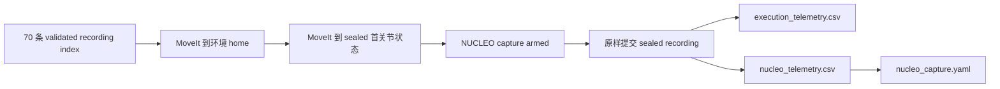

# 2026-08-29 ICASSP Phase-2 单次真机实验记录

本文记录环境 `new_board_4cm_rod33365_up50_icassp_phase2` 下，70 个候选
Phase-2 condition 各尝试一次真实 UR5 回放并同步采集 NUCLEO 磁场的实验方案、代码入口、
结果路径与异常处置。

最终结果不是 70/70 全部执行：68 个 condition 安全完成机器人回放并同时保存机器人实际
FK 与磁场数据；2 个 condition 的 sealed 首关节状态在当前 MoveIt 场景中与
`sensor_board_keepout` 碰撞，因此没有向控制器发送 playback。实验结束后，机械臂已通过
MoveIt 碰撞检查返回环境 home。

## 1. 实验目的与口径

本次实验是 Phase-2 条件集的一次单次真机链路检查，目标是：

1. 对选中的每个位置–方向 condition 执行一次 3 秒 settled revisit；
2. 保存真实关节状态和实际 FK，而不是只保存理想 waypoint；
3. 在 controller goal 提交前启动 NUCLEO capture，并将磁场帧映射到相同的主机单调时钟；
4. 每个 condition 分目录保存机器人表、磁场表和 capture manifest；
5. 对碰撞、动力学或传感器完整性异常 fail closed，不在 runtime 修改权威输入。

执行端始终遵守：不缩放、不重定时、不裁剪、不跳点，不修改任何 waypoint、`time_s`、
authority CSV 或 sealed recording。传感器板本次上电周期已经完成过 SYNC，因此本批次全部使用
`--nucleo-reuse-sync`，没有重复握手。

## 2. 条件与 recording 方案

70 条候选由下面的 clean build index 选择，每个 `condition_id` 只取一个状态为
`success` 或 `recovered`、manifest 为 `validated` 的 sealed recording：

```text
/data/ur-waypoint/icassp2027_phase2/
  build_evidence_reachable8_clean/exploratory/
  phase2_recording_build_index.csv
```

源 recording 位于：

```text
/data/ur-waypoint/icassp2027_phase2/workspace_reachable8/
  environments/new_board_4cm_rod33365_up50_icassp_phase2/recordings/
```

每个 condition 的 authority 是同一 Pose 的三行静态轨迹：

```csv
time_s,frame_id,tip_x_m,tip_y_m,tip_z_m,tip_qx,tip_qy,tip_qz,tip_qw,phase
0.000000000,plane1,...,draw
1.000000000,plane1,...,hold
3.000000000,plane1,...,hold
```

三行位置与姿态完全一致，`hold` 段严格静止。条件中的阵列坐标、磁铁坐标和杆尖坐标转换关系为：

```text
T_P_R = T_P_A @ T_A_M @ inv(T_R_M)
```

其中 `P=plane1`、`A=array`、`R=rod_tip`、`M=magnet`。注册参数冻结在
[`experiment_registration.exploratory.yaml`](../environments/new_board_4cm_rod33365_up50_icassp_phase2/experiment_registration.exploratory.yaml)。

## 3. 环境、工具与安全边界

| 项目 | 本次配置 |
|---|---|
| 环境 | `new_board_4cm_rod33365_up50_icassp_phase2` |
| 机器人 | UR5，IP `192.168.1.99` |
| 执行 controller | `/joint_trajectory_controller`，标准未缩放 controller |
| 工具 | 长 333.65 mm、直径 5 mm 的杆，`tool0 -> rod_tip` |
| 工作坐标 | `base -> plane1`，直接使用 UR Installation Plane Feature |
| 传感器板 | 0.40 m × 0.40 m，中心与 Feature 原点重合 |
| up50 后实际传感器面 | `plane1 z = -0.007 m` |
| 传感器 keepout | `plane1 z ∈ [-0.067, +0.100] m`，XY 为 `[-0.20,+0.20] m²` |
| 非杆尖最小净空 | 5 mm |

环境定义见：

- [`environment.yaml`](../environments/new_board_4cm_rod33365_up50_icassp_phase2/environment.yaml)
- [`setup.yaml`](../environments/new_board_4cm_rod33365_up50_icassp_phase2/setup.yaml)
- [`zones.yaml`](../environments/new_board_4cm_rod33365_up50_icassp_phase2/zones.yaml)
- [`robot_model.yaml`](../environments/new_board_4cm_rod33365_up50_icassp_phase2/robot/robot_model.yaml)

每条实验前都先到达下面的关节 home，再单独规划到 recording 的封存首关节状态；两个准备移动
都由 MoveIt OMPL RRTConnect 碰撞检查并通过 `/joint_trajectory_controller` 执行：

```text
[-2.264215638612, -1.362229481182, -1.056971395008,
 -2.253045531399,  1.573239787748,  1.570796326795]
```

## 4. 实际执行链路



实际批次命令的核心参数为：

```bash
cd /home/huaxin/Codes/ur-waypoint
source /opt/ros/jazzy/setup.bash
source install/setup.bash

bash scripts/run_phase2_repeat5_real_nucleo.sh \
  --port /dev/serial/by-id/usb-STMicroelectronics_STM32_Virtual_ComPort_3879336C3333-if00 \
  --repeats 1 \
  --reuse-existing-sync \
  --run-root /home/huaxin/Codes/ur-waypoint/runs/phase2_once_real_nucleo__20260829T071931Z
```

脚本因传感器质量门禁或首点规划失败停止后，使用同一 run root 和
[`resume_phase2_repeat5_real_nucleo.sh`](../scripts/resume_phase2_repeat5_real_nucleo.sh)
从尚未执行的 sequence 继续。已完成 condition 没有重复播放。

每条成功回放的输出关系为：

```text
execution_telemetry.csv
  └─ 实际关节位置/速度、controller reference、实际 FK、轨迹时间、speed scaling

nucleo_telemetry.csv
  └─ 四个 hub channel 的 64×3 原始磁场，按最近 robot sync_time_ns 映射

nucleo_capture.yaml
  └─ SYNC 模式、parser 统计、映射误差、覆盖率、文件 SHA-256
```

## 5. 实验前空场

运行 Phase-2 前，在机械臂不运动的状态下采集了新的 30 秒空场：

```text
/home/huaxin/Codes/ur-waypoint/runs/
  empty_field_30s_up50_after_phase2_stop__20260829T071513.178433Z__f5ccd11d/
```

| 指标 | 数值 |
|---|---:|
| 请求时长 | 30.0 s |
| 实际 capture clock 时长 | 30.0077 s |
| 四通道完整组 | 3009 |
| incomplete groups | 6 |
| timeout groups | 2 |
| duplicate/reordered packets | 1 / 1 |
| channel sequence drops | 31 |
| source sequence drops | 6 |
| malformed packets | 0 |
| UR 控制/运动 | 否/否 |

关键文件为 `nucleo_raw_telemetry.csv`、`nucleo_capture.yaml` 和 `sha256sums.txt`。原始 CSV
SHA-256 为：

```text
32a45b32f97c783b676b919528713e6ccf4d247e719c954b52a79a3b2c970969
```

## 6. 最终结果

| 项目 | 结果 |
|---|---:|
| 请求 condition | 70 |
| 机器人安全执行成功 | 68 |
| 首点碰撞阻止，未发送 playback | 2 |
| 机器人 telemetry 文件存在 | 68/68 |
| NUCLEO telemetry/manifest 存在 | 68/68 |
| NUCLEO manifest `complete` | 12 |
| 有界质量标记，原始 manifest 保持 `incomplete` | 55 |
| 超过当前有界门限 | 1 |
| 映射磁场组总数 | 20,344 |
| 每个成功 condition 的映射磁场组 | 289–306 |
| 全批次最大绝对时间映射误差 | 4.487140 ms |
| malformed/source-sequence/bytes-discarded | 0 / 0 / 0 |

这里每个 recording 只有约 3 秒，因此每条只有约 300 个磁场组，不能直接套用此前长轨迹
“约 3000 组允许丢 7–10 组”的比例判断。55 条有界质量记录采用的继续门限是：

```text
incomplete groups       <= 10
channel sequence drops  <= 10
duplicate packets       <= 10
reordered packets       <= 10
maximum mapping offset  <= 50 ms
其他 parser integrity delta 必须为 0
```

门限只决定批次是否继续，不修改 manifest，也不插值、伪造或补齐磁场数据。

### 6.1 两条未执行条件

| Sequence | Condition | MoveIt 接触对 | 穿入深度 | 处置 |
|---:|---|---|---:|---|
| 22 | `MAIN_EX_N_CTRL_Z13` | `upper_arm_link ↔ sensor_board_keepout` | 1.682 mm | 未启动 capture，未发送 playback |
| 60 | `MAIN_K_PN_CTRL_Z13` | `upper_arm_link ↔ sensor_board_keepout` | 2.200 mm | 未启动 capture，未发送 playback |

这两条 recording 的 manifest 虽被 clean index 选为 `validated/recovered`，但封存首关节状态在
真实运行时的 MoveIt planning scene 中无效。它们不能通过改变接近路径解决，因为目标状态本身
已经碰撞。原 authority 和 recording 均未修改；如需补做，必须在上游通过论文允许的磁矩正负
等价或 free roll 重新设计新 authority、重新 compile/mock/inspect，并先通过 MoveIt 状态检查。

### 6.2 一条传感器超门限条件

`MAIN_K_NN_DIF2_Z15`（sequence 70）机器人回放成功，机器人与磁场原始文件均已保存；其
NUCLEO playback window 为：

```text
mapped frames:          289
incomplete groups:       15
reordered packets:       15
channel sequence drops:  15
maximum mapping offset:   4.069 ms
malformed/source drops:   0 / 0
```

因此最终审计将其标记为 `INCOMPLETE_OVER_LIMIT`，不伪装为 complete。是否纳入正式统计应由
后续离线质量口径决定。

## 7. 代码路径

| 路径 | 作用 |
|---|---|
| [`generate_icassp_phase2_trajectories.py`](../scripts/generate_icassp_phase2_trajectories.py) | 将 conditions 与物理注册转换为 hash-bound authority CSV |
| [`build_icassp_phase2_recordings.py`](../scripts/build_icassp_phase2_recordings.py) | GPU compile、mock recording、inspect 与 build index |
| [`run_phase2_repeat5_real_nucleo.sh`](../scripts/run_phase2_repeat5_real_nucleo.sh) | 选择 70 条 recording、复制到 runtime、按 condition 真机执行 |
| [`resume_phase2_repeat5_real_nucleo.sh`](../scripts/resume_phase2_repeat5_real_nucleo.sh) | 保留同一 run root，从指定 sequence 续跑并记录有界传感器质量 |
| [`moveit_joint_prepare.py`](../scripts/moveit_joint_prepare.py) | 到 home 和 recording 首点的 MoveIt 碰撞检查与执行 |
| [`capture_empty_field.py`](../scripts/capture_empty_field.py) | 不控制机器人，仅采集命名空场并保存 manifest/SHA |
| [`cli.py`](../src/hx_waypoint_tools/hx_waypoint_tools/cli.py) | `tipdraw play`、NUCLEO sidecar 编排与质量门禁 |
| [`capture.py`](../src/hx_waypoint_nucleo/hx_waypoint_nucleo/capture.py) | 串口 capture、主机时间映射、联合表与 manifest |
| [`protocol.py`](../src/hx_waypoint_nucleo/hx_waypoint_nucleo/protocol.py) | hospital 协议解析、四通道分组与序列完整性统计 |
| [`runtime_node.cpp`](../src/hx_waypoint_runtime/src/runtime_node.cpp) | sealed recording action、起点门禁和 controller goal 提交 |
| [`runtime_policy.cpp`](../src/hx_waypoint_runtime/src/runtime_policy.cpp) | 禁止缩放、重定时、裁剪和跳点的执行策略 |
| [`telemetry_recorder.cpp`](../src/hx_waypoint_runtime/src/telemetry_recorder.cpp) | 实际关节、FK、reference 和 speed scaling 记录 |
| [`planning_scene_publisher.py`](../src/hx_waypoint_tools/hx_waypoint_tools/planning_scene_publisher.py) | 将环境碰撞几何发布到 MoveIt/RViz |

## 8. 结果路径与证据

### 8.1 Ubuntu24 原始批次

```text
/home/huaxin/Codes/ur-waypoint/runs/
  phase2_once_real_nucleo__20260829T071931Z/
```

该目录中的核心文件：

| 文件 | 含义 |
|---|---|
| `final_execution_audit.csv` | 70 条逐项最终审计；后续分析应以此为入口 |
| `final_execution_summary.json` | 68 成功、2 阻止及传感器质量汇总 |
| `selected_recordings.tsv` | sequence、condition 与 sealed recording 的确定映射 |
| `execution_schedule.csv` | 各次批处理实际追加记录；遇门禁停止的行可能不完整 |
| `bounded_sensor_loss_acceptance.csv` | 续跑阶段的传感器质量决策与 manifest 路径 |
| `NNNN__<condition>__r1.log` | 每个 sequence 的 playback 日志 |

每条成功 condition 的原始结果在：

```text
/home/huaxin/Codes/ur-waypoint/runs/
  <recording-id>__<real-run-timestamp>/real/
    execution_telemetry.csv
    nucleo_telemetry.csv
    nucleo_capture.yaml
```

结束时返回 home 的证据：

```text
/home/huaxin/Codes/ur-waypoint/runs/moveit_prepare_home__20260829_154815.json
```

### 8.2 仓库内审计副本

为便于版本控制，本次只复制了小型索引和审计文件，没有复制 68 份大型原始 telemetry：

- [final_execution_audit.csv](evidence/phase2-one-pass-real-20260829/final_execution_audit.csv)
- [final_execution_summary.json](evidence/phase2-one-pass-real-20260829/final_execution_summary.json)
- [selected_recordings.tsv](evidence/phase2-one-pass-real-20260829/selected_recordings.tsv)
- [execution_schedule.csv](evidence/phase2-one-pass-real-20260829/execution_schedule.csv)
- [bounded_sensor_loss_acceptance.csv](evidence/phase2-one-pass-real-20260829/bounded_sensor_loss_acceptance.csv)

最终审计文件 SHA-256：

```text
bfd337ef85c2bec15a29fb47c75368198f8f1b4de39f711321ecd7e975d58e56  final_execution_audit.csv
cfce3ff4de6344b8935494d80fc06aa7e6b7aaa3255408c39d315100df5ff2f4  final_execution_summary.json
```

## 9. 实验结束状态与后续约束

- Phase-2 batch、`tipdraw play`、NUCLEO capture 和 MoveIt prepare 子进程均已退出；
- UR5 已返回 hash-bound home；ROS real runtime/controller 当时仍保持 active；
- 68 条成功 condition 均有独立机器人表和磁场表；
- 2 条碰撞条件不应被计为缺失传感器数据，而应计为未执行的不可达/碰撞条件；
- sequence 70 应单独进行离线质量决策；
- 后续若补做两条碰撞 condition，只能上游生成新候选，不能 runtime 自动修改原 recording。
