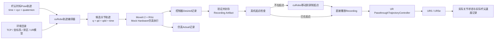

## 一、最终数据链路



整个系统只有两个会调用 cuRobo 的阶段：

1. 生成录制文件之前的完整轨迹编译。
2. 真机当前姿态不在录制起点时，单独执行一次 `prepare` 移动。

真正播放绘图记录时不调用 cuRobo，不调用 MoveIt IK，也不逐点解算。

---

# 二、cuRobo 现在就是正式依赖

cuRobo 不再是“可选后端”，而是系统唯一的轨迹编译后端。MoveIt 2 不负责轨迹 IK，只负责 RViz 场景显示、mock hardware 执行和独立验证。

当前 cuRobo 官方仓库已经进入 cuRoboV2，官方明确说明 V2 是一次较大的重写，公共 API 与 V1 不同。因此项目不能直接在业务代码中到处调用 cuRobo API，而应增加一个薄的 `CuroboAdapterV2`，并锁定具体 cuRobo release 或 Git commit，不能直接跟踪 `main`。cuRobo 本身提供 GPU 运动学、碰撞检查、IK、轨迹优化和运动生成能力。([GitHub](https://github.com/nvlabs/curobo "GitHub - NVlabs/curobo: CUDA Accelerated Robot Library · GitHub"))

推荐职责如下：

```text
cuRobo：
  机器人运动学
  杆子的附加碰撞模型
  环境碰撞检查
  批量碰撞约束IK
  IK分支候选生成
  关节路径优化
  速度、加速度、jerk平滑
  recording 之外的独立 prepare 自由空间规划

MoveIt 2：
  RViz显示
  PlanningScene显示
  Mock Hardware仿真执行
  仿真过程关节状态记录
  可选的独立碰撞复核

ros2_control：
  仿真和真机的JointTrajectory执行

C++ Runtime：
  状态机、记录、封存、播放、安全检查、实际速度输出
```

cuRobo 的机器人碰撞模型采用附着在 link 上的碰撞球近似，所以杆子不能只存在于 TCP 数学变换里；必须作为附加在 `tool0` 上的碰撞球链或等效碰撞模型进入 cuRobo 机器人配置。([cuRobo](https://curobo.org/get_started/1a_quick_overview.html?utm_source=chatgpt.com "Basics"))

---

# 三、绘图轨迹在 cuRobo 中的处理

不能简单地对每个杆尖 Pose 独立调用 IK。推荐的 `CuroboTimedPathCompiler` 流程是：

```text
输入杆尖Pose轨迹
    ↓
按输入时间轴增加内部密集约束（逐点保留全部源 waypoint）
    ↓
杆尖Pose转换为tool0目标Pose
    ↓
cuRobo批量生成每个Pose的多个无碰撞IK候选
    ↓
选择连续的IK分支
    ↓
cuRobo轨迹优化
    ↓
检查杆尖FK误差、碰撞、关节限制、速度、加速度和jerk
    ↓
生成q(t)、qd(t)、qdd(t)
```

其中：

* 每一个绘图 Pose 都是约束，不允许自动跳过。
* 输入时间戳是权威时间。
* cuRobo 不得静默改变绘图速度。
* 如果输入时间导致速度、加速度或 jerk 超限，直接拒绝。
* 不存在可启用的时间缩放、重定时、裁剪、改点或跳点模式。
* IK 连续性目标同时考虑：
  * 与上一点的关节距离；
  * 关节速度；
  * 关节加速度；
  * jerk；
  * 与关节极限的距离；
  * 碰撞余量；
  * 奇异性指标。

canonical recording 只包含源 CSV 的 `DRAW/HOLD`。如机械臂不在
source `t=0` 起点，cuRobo 只生成一条 recording 之外的独立 `prepare`
轨迹；prepare 先作为单独 controller goal 执行并完成起点复核，绝不
拼接进 canonical 轨迹。

---

# 四、项目目录

```text
hx_waypoint/
├── src/
│   ├── hx_waypoint_interfaces/
│   │   ├── action/
│   │   │   ├── BuildRecording.action
│   │   │   └── PlayRecording.action
│   │   └── msg/
│   │       └── ExecutionTelemetry.msg
│   │
│   ├── hx_waypoint_curobo/
│   │   ├── hx_waypoint_curobo/
│   │   │   ├── curobo_server.py
│   │   │   ├── curobo_adapter_v2.py
│   │   │   ├── environment_builder.py
│   │   │   ├── robot_tool_builder.py
│   │   │   ├── timed_pose_compiler.py
│   │   │   ├── continuous_ik_selector.py
│   │   │   ├── trajectory_optimizer.py
│   │   │   └── trajectory_exporter.py
│   │   └── requirements.lock
│   │
│   ├── hx_waypoint_runtime/
│   │   ├── include/hx_waypoint/
│   │   │   ├── simulation_runner.hpp
│   │   │   ├── trajectory_recorder.hpp
│   │   │   ├── recording_store.hpp
│   │   │   ├── playback_executor.hpp
│   │   │   ├── safety_gate.hpp
│   │   │   └── telemetry_recorder.hpp
│   │   └── src/
│   │       ├── simulation_runner.cpp
│   │       ├── trajectory_recorder.cpp
│   │       ├── recording_store.cpp
│   │       ├── playback_executor.cpp
│   │       ├── safety_gate.cpp
│   │       ├── telemetry_recorder.cpp
│   │       └── runtime_node.cpp
│   │
│   ├── hx_waypoint_tools/
│   │   ├── cli.py
│   │   ├── trajectory_generator.py
│   │   ├── orientation_generator.py
│   │   └── report_plotter.py
│   │
│   └── hx_waypoint_bringup/
│       └── launch/
│           ├── simulation.launch.py
│           └── real.launch.py
│
├── environments/
│   └── lab_wall_a/
│       ├── environment.yaml
│       ├── setup.yaml
│       ├── zones.yaml
│       ├── planner.yaml
│       ├── recording.yaml
│       ├── controllers.yaml
│       ├── robot/
│       │   ├── robot_model.yaml
│       │   ├── calibrated_kinematics.yaml
│       │   ├── curobo_robot.yaml
│       │   └── collision_spheres.yaml
│       ├── meshes/
│       ├── trajectories/
│       └── recordings/
│
└── runs/
```

这样每一个环境目录都包含：

* 对应机器人型号；
* 机器人标定参数；
* TCP 和杆长；
* 杆碰撞模型；
* 坐标变换；
* 禁区；
* cuRobo 参数；
* 仿真和真机控制器；
* 轨迹；
* 已经通过仿真的录制文件。

---

# 五、RViz 仿真方式

你所说的“MoveIt 2 自带 RViz 仿真”，具体落地为：

```text
UR mocked hardware
+ ros2_control JointTrajectoryController
+ robot_state_publisher
+ MoveIt move_group
+ RViz MoveIt插件
+ 环境PlanningScene
+ hx_waypoint trajectory recorder
```

RViz 本身负责显示，mock hardware 和 `JointTrajectoryController` 负责执行关节轨迹。UR 官方 MoveIt 配置支持连接真实硬件、URSim 或 mocked hardware，并通过 `launch_rviz:=true` 启动 RViz。([Universal Robots 文件平台](https://docs.universal-robots.com/Universal_Robots_ROS_Documentation/jazzy/doc/ur_robot_driver/ur_moveit_config/doc/index.html "ur_moveit_config — Universal Robots ROS 2 Driver Documentation 0.1 documentation"))

仿真流程必须是：

```text
CUROBO_COMPILE 完全结束
        ↓
生成完整候选JointTrajectory
        ↓
关闭所有轨迹解算活动
        ↓
启动记录器
        ↓
一次性发送完整JointTrajectory
        ↓
RViz中完整运动
        ↓
记录器结束
        ↓
验证并封存
```

因此，cuRobo 花费 0.1 秒、2 秒还是 20 秒都不会进入记录时间。

---

# 六、如何保证“不含解算停顿”

系统中同时保留两种时间：

```text
ros_time_s
trajectory_time_s
```

其中：

* `ros_time_s`：ROS 的实际墙钟时间，用于诊断。
* `trajectory_time_s`：轨迹执行时间，用于录制和真机播放。

最终播放文件只能使用 `trajectory_time_s`。

录制器只有在以下条件全部满足后才开始：

```text
cuRobo已经返回成功
轨迹已经通过验证
仿真控制器已经接受Action
控制器进入EXECUTING状态
```

`t=0` 对应第一条真实轨迹点，而不是：

* 程序启动时间；
* cuRobo 开始解算时间；
* 文件读取时间；
* Action 等待服务器时间；
* RViz 启动时间。

任何解算停顿都发生在 `CUROBO_COMPILE` 状态，不可能被写进最终 `time_from_start`。

只有用户在源轨迹里显式定义的停留才会进入记录，例如：

```csv
time_s,...,phase
2.000,...,draw
2.500,...,hold
3.000,...,draw
```

---

# 七、不能只录 `/joint_states`

你要求的关节记录会分为两份。

## 1. 真机播放使用的标准记录

```text
joint_trajectory.csv
```

记录的是仿真控制器实际使用的 desired trajectory：

```csv
time_s,
shoulder_pan_pos,shoulder_lift_pos,elbow_pos,wrist_1_pos,wrist_2_pos,wrist_3_pos,
shoulder_pan_vel,shoulder_lift_vel,elbow_vel,wrist_1_vel,wrist_2_vel,wrist_3_vel,
shoulder_pan_acc,shoulder_lift_acc,elbow_acc,wrist_1_acc,wrist_2_acc,wrist_3_acc,
phase
```

它包含：

* 关节位置 (q)
* 关节速度 (\dot q)
* 关节加速度 (\ddot q)
* `time_from_start`
* 轨迹阶段

## 2. 仿真实际状态记录

```text
sim_actual_joint.csv
```

来自：

```text
/joint_states
/controller_name/controller_state
```

`JointTrajectoryController` 官方提供 `controller_state` topic，并以 controller manager 的更新频率发布 desired、actual 和 error 状态。([控制ROS](https://control.ros.org/rolling/doc/ros2_controllers/joint_trajectory_controller/doc/userdoc.html "joint_trajectory_controller — ROS2_Control: Rolling Jul 2026 documentation"))

仿真实际状态用于检查：

* 控制器是否接受轨迹；
* 仿真是否完整执行；
* desired 和 actual 是否一致；
* 是否有异常停顿；
* 起点和终点是否正确。

但它不直接作为真机命令，因为 ROS topic 到达时间可能存在调度抖动。更不能对有抖动的实际位置直接做差分后生成速度、加速度，再拿去控制真机。

---

# 八、为什么必须记录位置、速度和加速度

最终播放文件必须包含：

```text
q + qd + qdd
```

不能只存关节位置。

ros2_control 的 spline 插值规则是：

* 只有位置：线性插值，速度在 waypoint 处不连续；
* 位置和速度：三次插值，速度连续；
* 位置、速度和加速度：五次插值，加速度连续。([控制ROS](https://control.ros.org/rolling/doc/ros2_controllers/joint_trajectory_controller/doc/trajectory.html "Trajectory Representation — ROS2_Control: Rolling Jul 2026 documentation"))

因此，为获得平顺的真机播放，采用：

```yaml
trajectory_fields:
  position: true
  velocity: true
  acceleration: true

controller_interpolation: spline
```

并且 `q、qd、qdd` 必须来自同一个 cuRobo 优化轨迹的解析导数或同一 B-spline，不应分别计算。否则相互不一致的状态可能造成 spline 过冲，ros2_control 官方文档也特别提示了这一问题。([控制ROS](https://control.ros.org/rolling/doc/ros2_controllers/joint_trajectory_controller/doc/trajectory.html "Trajectory Representation — ROS2_Control: Rolling Jul 2026 documentation"))

---

# 九、关节坐标系也一并记录

这里把“UR 的关节坐标系”同时实现为两类数据。

第一类是用于播放的六关节坐标：

```text
q1 ... q6
qd1 ... qd6
qdd1 ... qdd6
```

第二类是用于分析和可视化的各关节 frame：

```text
base_link → shoulder frame
base_link → upper_arm frame
base_link → forearm frame
base_link → wrist_1 frame
base_link → wrist_2 frame
base_link → wrist_3 frame
base_link → tool0
base_link → rod_tip
```

输出：

```text
joint_frames.csv
```

格式例如：

```csv
time_s,frame_id,x_m,y_m,z_m,qx,qy,qz,qw
0.000,shoulder_link,...
0.000,upper_arm_link,...
0.000,forearm_link,...
0.000,wrist_1_link,...
...
```

这些 frame 通过同一机器人模型做 FK 得到，用于检查机械臂各 link 的姿态。真机播放只使用 `joint_trajectory.csv`，不使用 frame 文件。

---

# 十、最终 Recording 目录

一次仿真成功后生成：

```text
environments/lab_wall_a/recordings/
└── circle_01__20260716_153012/
    ├── manifest.yaml
    ├── source_tip_trajectory.csv
    ├── joint_trajectory.csv
    ├── joint_frames.csv
    ├── sim_controller_state.csv
    ├── sim_actual_joint.csv
    ├── sim_actual_tip.csv
    ├── validation_report.yaml
    ├── environment_snapshot/
    │   ├── environment.yaml
    │   ├── setup.yaml
    │   ├── zones.yaml
    │   ├── planner.yaml
    │   ├── recording.yaml
    │   └── controllers.yaml
    └── sha256sums.txt
```

`manifest.yaml`：

```yaml
schema_version: 1
recording_id: circle_01__20260716_153012
status: validated

environment_id: lab_wall_a
trajectory_id: circle_01

robot:
  type: ur5e
  joint_names:
    - shoulder_pan_joint
    - shoulder_lift_joint
    - elbow_joint
    - wrist_1_joint
    - wrist_2_joint
    - wrist_3_joint

trajectory:
  duration_s: 18.42
  point_count: 1843
  nominal_dt_s: 0.010
  interpolation: spline
  fields: [position, velocity, acceleration]

validation:
  simulation_completed: true
  controller_result: succeeded
  max_tip_position_error_m: 0.00042
  max_tip_orientation_error_deg: 0.31
  minimum_collision_distance_m: 0.007
  max_joint_velocity_ratio: 0.68
  max_joint_acceleration_ratio: 0.59

hashes:
  robot_model: ...
  calibrated_kinematics: ...
  tcp: ...
  frames: ...
  zones: ...
  source_trajectory: ...
  curobo_revision: ...
```

只有：

```yaml
status: validated
```

的记录允许真机播放。

---

# 十一、真机直接播放

真机运行时不重新打开原始杆尖 CSV，也不做 IK。

流程为：

```text
加载validated recording
        ↓
校验机器人型号和joint_names
        ↓
校验UR标定文件hash
        ↓
校验TCP、杆长、坐标系和禁区hash
        ↓
读取真实当前关节位置
        ↓
检查是否接近recording第一点
        ↓
整条JointTrajectory一次性发送
```

起点检查：

[
\max_i |q_i^{actual} - q_i^{recording}(0)| < \epsilon_q
]

例如：

```yaml
start_state:
  max_joint_error_rad: 0.02
  settle_velocity_rad_s: 0.01
```

如果不满足，不允许直接插入第一条轨迹点。系统有两个行为：

```yaml
start_mismatch_policy: reject
```

或者：

```yaml
start_mismatch_policy: curobo_prepare
```

`curobo_prepare` 会先单独生成一条从当前姿态到 recording 起点的安全轨迹。该轨迹执行完成并稳定后，才开始 `t=0` 的正式记录播放。准备阶段的规划时间和停顿不属于绘图记录。

---

# 十二、真机使用 PassthroughTrajectoryController

真机默认不使用 PC 端持续插值，而使用：

```text
/passthrough_trajectory_controller/follow_joint_trajectory
```

UR 的 `PassthroughTrajectoryController` 会把完整轨迹转发给机器人控制器，由机器人控制器负责插值和执行，从而降低控制 PC 的实时性要求。控制器本身支持 speed scaling，但本项目要求正式 recording 播放前及播放期间 speed scaling 始终为 `1.0`；缺少新鲜状态或发生偏离时立即取消并报错，不能把控制器缩放当作允许的重定时。官方同时说明，该控制器只能用于真实 UR 或 URSim，不能用于 mock hardware 或 Gazebo。([Universal Robots 文件平台](https://docs.universal-robots.com/Universal_Robots_ROS2_Documentation/doc/ur_robot_driver/ur_controllers/doc/index.html?utm_source=chatgpt.com "ur_controllers — Universal Robots ROS 2 Driver ..."))

因此控制器配置明确分开：

```yaml
simulation:
  controller_type: joint_trajectory_controller
  action_name: /joint_trajectory_controller/follow_joint_trajectory
  interpolation: spline

real:
  controller_type: passthrough_trajectory_controller
  action_name: /passthrough_trajectory_controller/follow_joint_trajectory
  interpolation: spline
```

不能在仿真时尝试使用 passthrough controller，因为 mocked hardware 不支持它；但两端使用的是同一份 `q、qd、qdd、time_from_start` 数据。

部署时必须检查当前安装的 Jazzy UR driver 是否包含 `PassthroughTrajectoryController`。如果现有二进制版本较旧，不应静默退回逐点流式发送，而应锁定并源码安装包含该控制器的兼容 UR driver 版本。

---

# 十三、实际速度输出仍然保留

真机播放期间记录：

```text
actual q
actual qd
actual tip pose
actual tip linear velocity
actual tip angular velocity
desired tip speed
speed scaling
tracking error
```

杆尖实际速度：

[
V_{tip} = J_{tip}(q)\dot q
]

输出：

```csv
ros_time_s,
trajectory_time_s,
q1,q2,q3,q4,q5,q6,
qd1,qd2,qd3,qd4,qd5,qd6,
tip_x,tip_y,tip_z,
tip_vx,tip_vy,tip_vz,
actual_tip_speed_mps,
tip_wx,tip_wy,tip_wz,
actual_tip_angular_speed_radps,
desired_tip_speed_mps,
position_error_m,
speed_scaling
```

`speed_scaling` 仅作为执行证据记录。正式播放的权威 `trajectory_time_s`
只能来自 controller feedback，不能用墙钟时间或 `wall_dt * speed_scaling`
推算；任何 speed scaling 偏离 `1.0` 都必须取消轨迹并报错。([Universal Robots 文件平台](https://docs.universal-robots.com/Universal_Robots_ROS2_Documentation/doc/ur_robot_driver/ur_controllers/doc/index.html "ur_controllers — Universal Robots ROS 2 Driver Documentation 0.1 documentation"))

所以：

* 轨迹文件中的速度是标称速度；
* recording 中保存的是标称关节时间；
* 真机输出中保存的是实际速度；
* 两者不能混为一个字段。

---

# 十四、配置示例

`recording.yaml`：

```yaml
schema_version: 1

recording:
  sample_dt_s: 0.010
  time_source: trajectory_time

  canonical_source: controller_desired
  record_controller_actual: true
  record_joint_states: true
  record_joint_frames: true
  record_tip_state: true

  output_fields:
    positions: true
    velocities: true
    accelerations: true

  first_point:
    time_s: 0.0
    require_zero_velocity: true

  last_point:
    require_zero_velocity: true
    require_zero_acceleration: true

  validation:
    max_missing_samples: 0
    max_time_jitter_s: 0.002
    require_action_success: true
```

`planner.yaml`：

```yaml
schema_version: 1

backend:
  type: curobo_v2
  device: cuda:0
  revision_lock: curobo.lock

curobo:
  warmup_on_start: true
  robot_config: robot/curobo_robot.yaml
  collision_spheres: robot/collision_spheres.yaml

timed_path:
  preserve_input_timestamps: true
  nominal_output_dt_s: 0.010
  max_translation_step_m: 0.002
  max_rotation_step_deg: 1.0

ik:
  candidates_per_pose: 32
  use_previous_solution_seed: true
  reject_branch_jump_rad: 0.25

optimization:
  position_weight: 1.0
  orientation_weight: 1.0
  velocity_weight: 0.1
  acceleration_weight: 0.1
  jerk_weight: 0.05
  collision_weight: 1.0

limits:
  on_violation: reject
  allow_uniform_time_scale: false
```

---

# 十五、运行命令

生成、仿真、记录、验证一次完成：

```bash
ros2 run hx_waypoint_tools tipdraw build-recording \
  --env lab_wall_a \
  --trajectory circle_01 \
  --rviz
```

内部执行：

```text
加载环境
→ cuRobo warmup
→ cuRobo编译完整轨迹
→ 生成q/qd/qdd
→ 启动MoveIt 2 + RViz + mock hardware
→ 仿真执行
→ 记录关节轨迹和joint frames
→ 验证
→ 封存recording
```

查看记录：

```bash
ros2 run hx_waypoint_tools tipdraw inspect \
  --env lab_wall_a \
  --recording circle_01__20260716_153012
```

真机播放：

```bash
ros2 run hx_waypoint_tools tipdraw play \
  --env lab_wall_a \
  --recording circle_01__20260716_153012 \
  --auto-prepare
```

播放时只执行：

```text
校验
→ 必要时cuRobo移动到起点
→ 整条记录一次性发送
→ 记录真机actual状态
```

不执行：

```text
不读取杆尖Pose重新解算
不逐点IK
不重新选择IK分支
不重新轨迹优化
不逐点等待cuRobo
不通过rosbag按消息到达时间播放
```

最终核心结构就是：

```text
杆尖时标Pose
    ↓
cuRobo离线编译
    ↓
完整q/qd/qdd轨迹
    ↓
MoveIt 2 RViz仿真执行并记录
    ↓
封存为validated recording
    ↓
真机Passthrough整条播放
    ↓
输出真实关节状态、杆尖速度和跟踪误差
```

这套结构满足完整姿态、杆 TCP、禁区、cuRobo、RViz 仿真、无解算停顿记录、关节坐标及关节 frame 记录，以及真机直接平滑播放。
